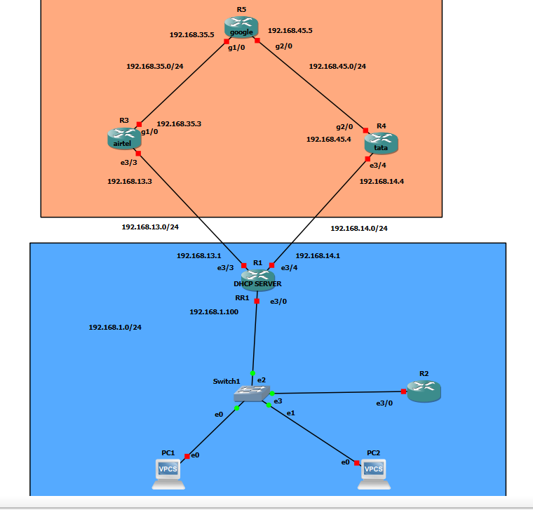
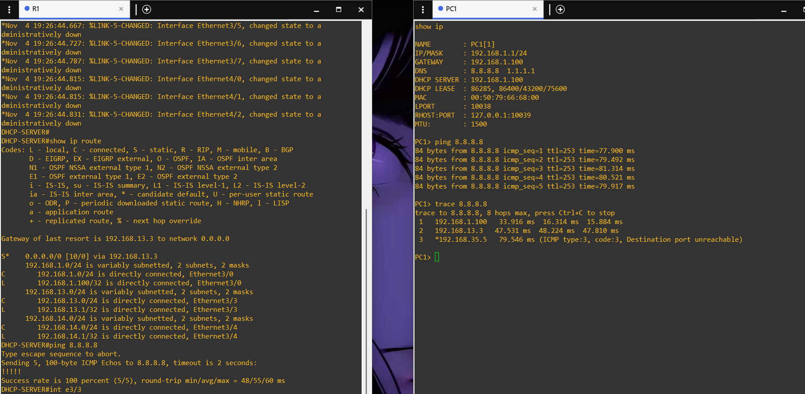
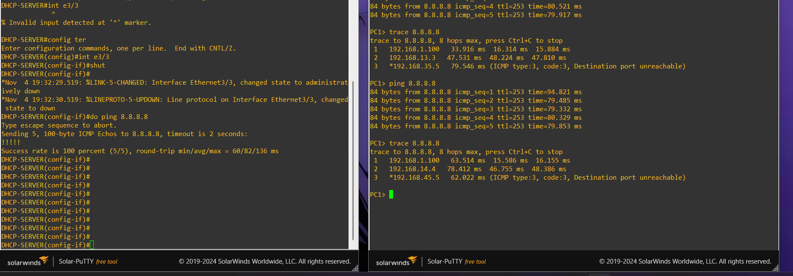
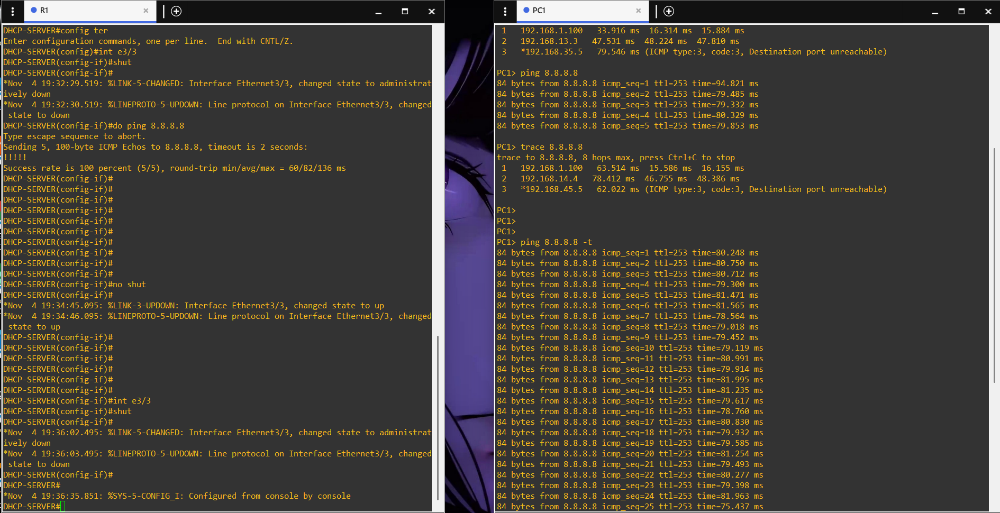
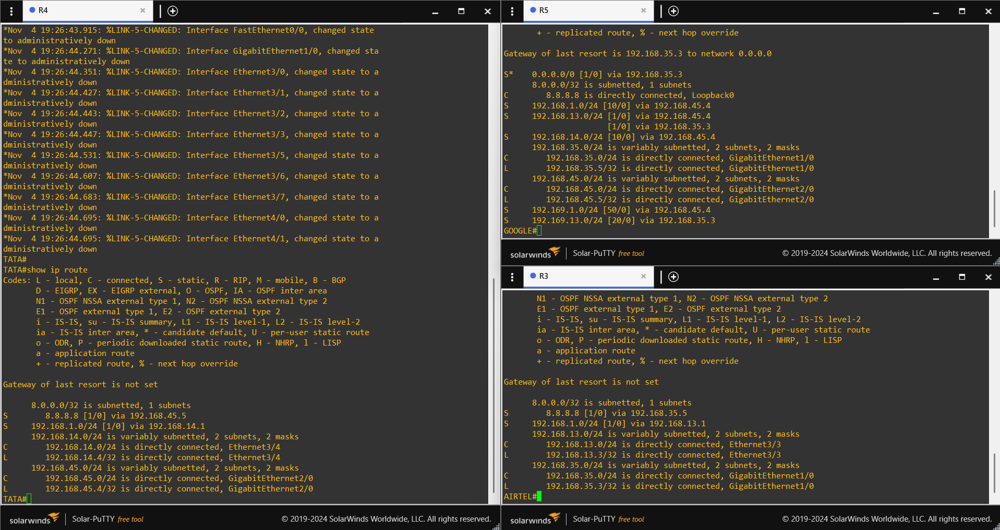

# Day 10 — Static Routing and Default Routing

This section covers static routes, default routes, administrative distance, and floating static routes. The lab uses two ISP paths—Airtel and Tata—to provide a primary route and a backup route to a simulated Internet destination.

## Topics and notes

| Topic | Notes |
|---|---|
| Static routing | [Static route fundamentals and route configuration](static-routing.md) |
| Default routing | [Default route, gateway of last resort, and route lookup](default-routing.md) |
| Administrative distance and failover | [Floating static route and dual-ISP lab](floating-static-route-and-failover.md) |
| Revision | [Important interview and practice questions](practice-questions.md) |

## Lab overview

The topology contains the office LAN, R1 as the office router/DHCP server, R3 as Airtel, R4 as Tata, and R5 as the simulated Google destination. The PCs connect to the office LAN through Switch1.

## Lab observations

1. PC1 received its network settings: `192.168.1.1/24`, gateway `192.168.1.100`, and DHCP server `192.168.1.100`.
2. PC1 successfully pinged `8.8.8.8`.
3. The first traceroute showed the Airtel path: R1 (`192.168.1.100`) → Airtel (`192.168.13.3`) → R5 (`192.168.35.5`).
4. I shut down R1's Airtel-facing Ethernet3/3 interface.
5. The later traceroute showed the Tata path: R1 (`192.168.1.100`) → Tata (`192.168.14.4`) → R5 (`192.168.45.5`).
6. The continuous ping screenshot shows successful replies during the test after the path change.

## Lab screenshots

**PC1 addressing, ping, and initial traceroute**

**Airtel interface shutdown and traceroute through Tata**

**Continuous ping test**

**Router routing tables**

## Important lab distinction

The address `8.8.8.8` is configured as a loopback destination on R5 in this topology. The successful ping proves connectivity to that simulated destination inside the lab. These screenshots do not demonstrate access to the real public Internet or a NAT configuration.
