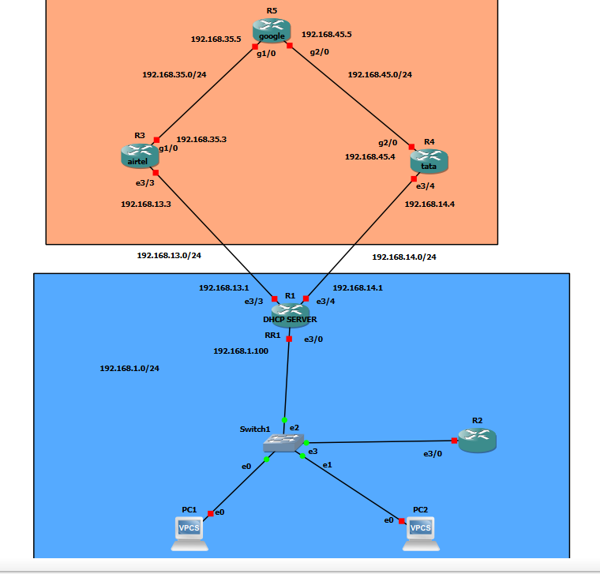
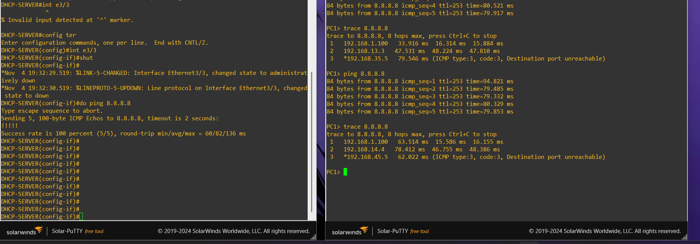
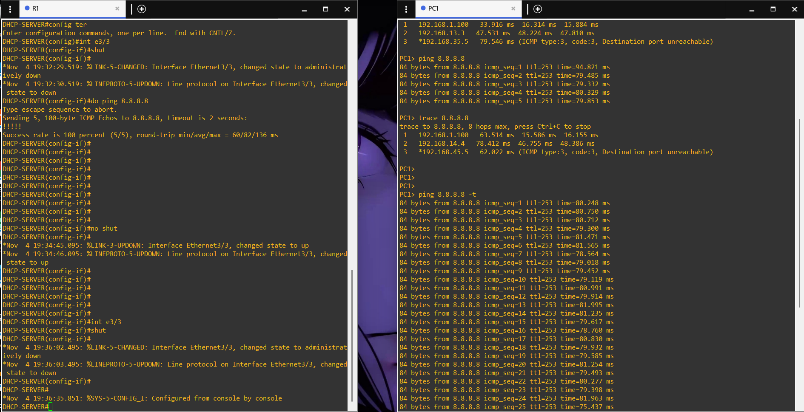

# Floating Static Route and Dual-ISP Failover

## What is a floating static route?

A floating static route is a static route configured with a higher administrative distance than the preferred route to the same destination prefix. It remains as a backup and is selected when the preferred route is no longer available in the routing table.

A lower administrative distance has higher preference.

## Dual-ISP example from class

The class material used two ISP connections:
- Airtel as the primary path.
- Tata as the backup path.

The lab topology connects R1 to Airtel R3 through `192.168.13.0/24` and to Tata R4 through `192.168.14.0/24`. Both paths lead to R5, where `8.8.8.8` is configured as a loopback destination.



## Route preference shown in the lab

The R1 routing-table screenshot shows the installed default route:

```text
S* 0.0.0.0/0 [10/0] via 192.168.13.3
```

The class example discusses different administrative distances for primary and backup static routes. The intended preference is that Airtel has the lower AD and Tata has the higher AD. The captured R1 routing-table output visibly confirms the Airtel route as the installed default route; it does not display the backup route while the primary route is active.

## Failover test I performed

1. PC1 initially reached `8.8.8.8` using the Airtel path.
2. The initial traceroute showed R1 (`192.168.1.100`), Airtel (`192.168.13.3`), and R5 (`192.168.35.5`).
3. On R1, I entered interface configuration for Ethernet3/3 and issued `shutdown`.
4. The console showed Ethernet3/3 and its line protocol changing to down.
5. I ran traceroute again from PC1. The path now showed R1 (`192.168.1.100`), Tata (`192.168.14.4`), and R5 (`192.168.45.5`).
6. The continuous ping screenshot shows successful replies during the test after the path change.





## Commands used during the test

```text
show ip route
config terminal
interface e3/3
shutdown
no shutdown
```

## What this test demonstrates

The traceroute change demonstrates that the forwarding path changed from Airtel to Tata after the Airtel-facing interface was shut down. The continuous ping screenshot shows successful replies during the test.

The screenshots do not show the complete before-and-after R1 routing table, so the exact backup-route installation event is not independently visible. The observed path change is the practical result documented here.
