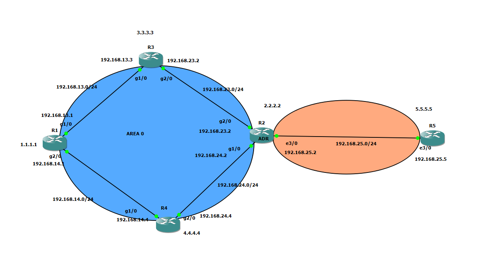
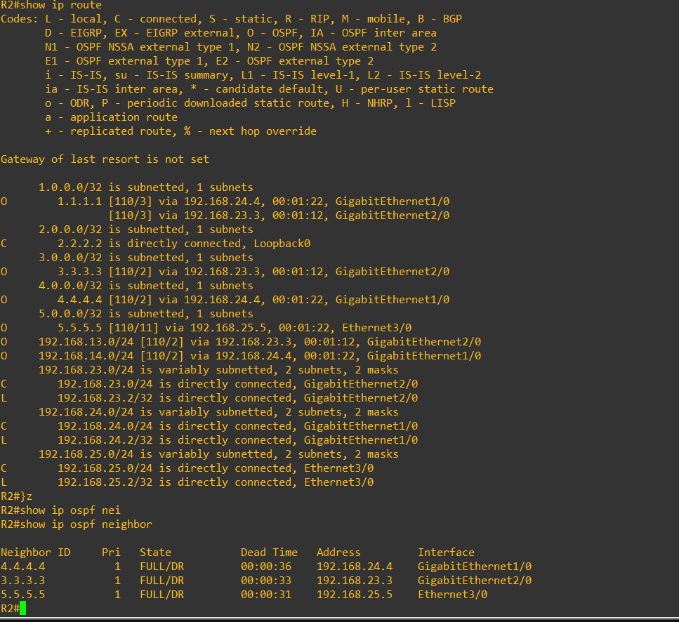
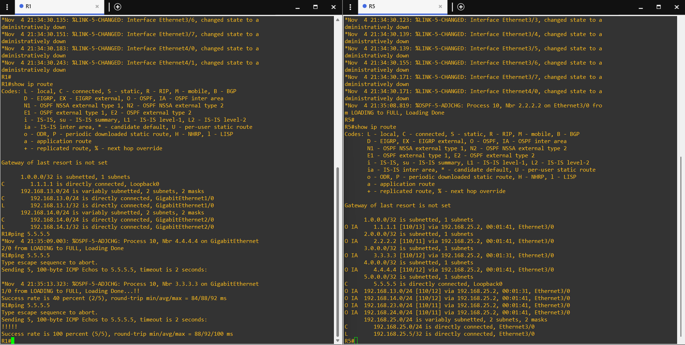
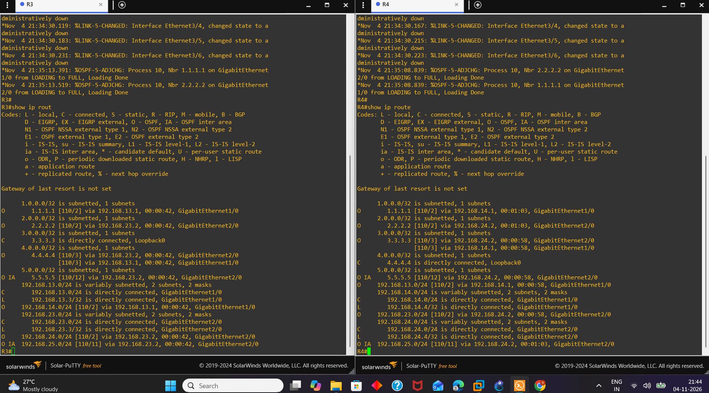
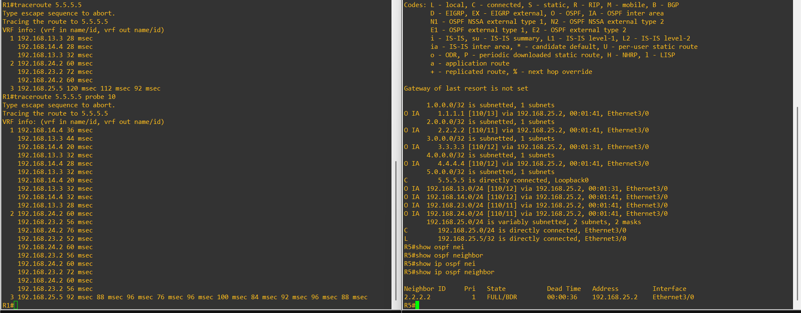

# Day 11 — Dynamic Routing and OSPF

This section covers dynamic routing fundamentals and the OSPF configuration and verification completed in the lab.

## Topics and notes

| Topic | Notes |
|---|---|
| Dynamic routing | [Dynamic routing fundamentals and routing protocol types](dynamic-routing-fundamentals.md) |
| OSPF configuration | [OSPF configuration, wildcard masks, and multi-area design](ospf-multi-area-configuration.md) |
| OSPF path selection | [OSPF cost, route types, and equal-cost load balancing](ospf-cost-and-load-balancing.md) |
| Revision | [Interview and practice questions](practice-questions.md) |

## Practical topology

The topology contains five routers. R1, R2, R3, and R4 are in Area 0. R2 connects Area 0 to R5 through the 192.168.25.0/24 network in Area 10, so R2 functions as the Area Border Router (ABR).



## OSPF configuration and neighbor verification

OSPF process 10 is used in the lab. The routing and neighbor outputs below show the resulting OSPF operation after configuration.

On R2, `show ip ospf neighbor` displays three neighbors in the FULL state:

| Neighbor ID | Neighbor address | R2 interface | State |
|---|---|---|---|
| 4.4.4.4 (R4) | 192.168.24.4 | GigabitEthernet1/0 | FULL/DR |
| 3.3.3.3 (R3) | 192.168.23.3 | GigabitEthernet2/0 | FULL/DR |
| 5.5.5.5 (R5) | 192.168.25.5 | Ethernet3/0 | FULL/DR |



## Routing-table verification

The following screenshots show the routing tables on the routers. Routes marked `O` are OSPF routes, while `O IA` identifies OSPF inter-area routes. The displayed OSPF routes have an administrative distance of 110.

### R1 and R5

The left terminal shows R1's connected networks and the ping test to R5's loopback address, 5.5.5.5. The right terminal shows R5's OSPF-learned routes to the Area 0 networks.



### R3 and R4

These outputs show the OSPF routes learned by R3 and R4, including routes to the remote loopback networks and the 192.168.25.0/24 network.



## End-to-end connectivity test

R1 was used to test reachability to R5's loopback address, 5.5.5.5.

- The first ping attempt received 2 replies out of 5 (40%) while OSPF neighbor state changes were still appearing.
- The subsequent ping received 5 replies out of 5 (100%).

The successful second test confirms end-to-end IP reachability from R1 to R5 after OSPF converged.

## OSPF equal-cost load balancing

The traceroute from R1 to 5.5.5.5 is the load-balancing test, not a routing-table screenshot. It shows probe responses through both available paths:

- First hop: 192.168.13.3 (R3) and 192.168.14.4 (R4).
- Second hop: 192.168.23.2 and 192.168.24.2.
- Final hop: 192.168.25.5 (R5).

The extended traceroute using 10 probes also shows responses through both paths. This is consistent with OSPF equal-cost multipath (ECMP) forwarding. The output demonstrates that probes use both paths; it does not establish whether load sharing is per-packet or per-destination.



This screenshot shows the traceroute probes taking both available paths toward R5. It is kept separate from the router routing-table screenshots above.

## Verification commands

```text
show ip interface brief
show running-config | section router ospf
show ip ospf neighbor
show ip ospf database
show ip route
show ip protocols
ping 5.5.5.5
traceroute 5.5.5.5
traceroute 5.5.5.5 probe 10
```
