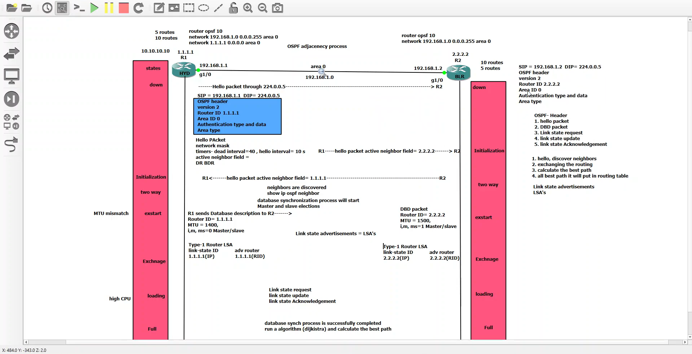
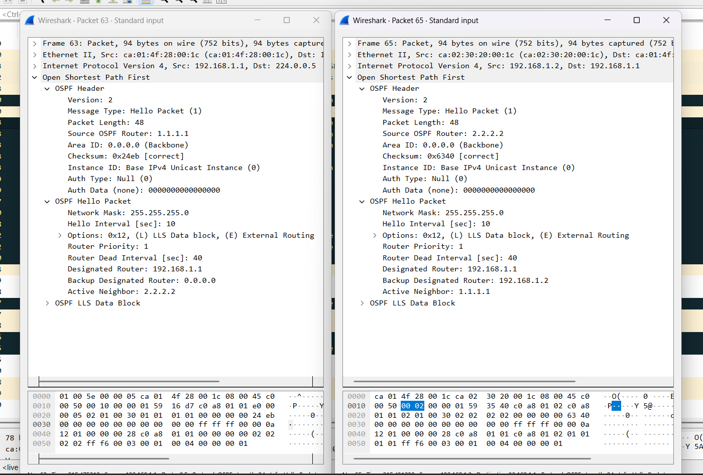
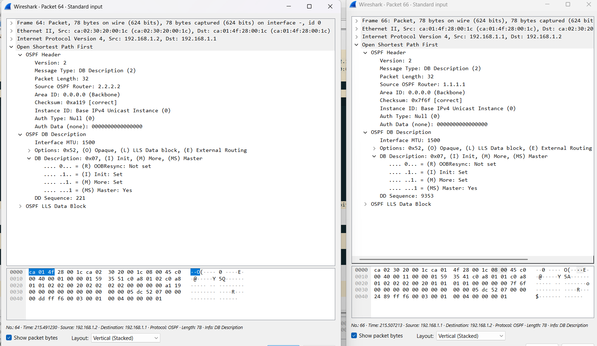
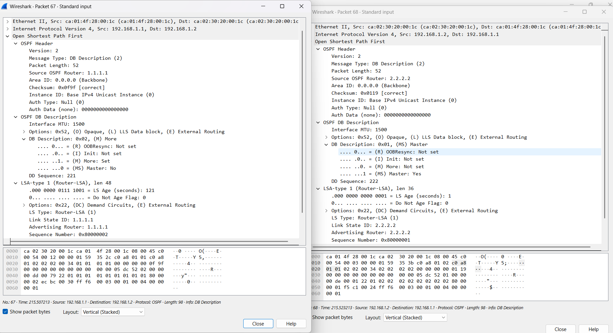
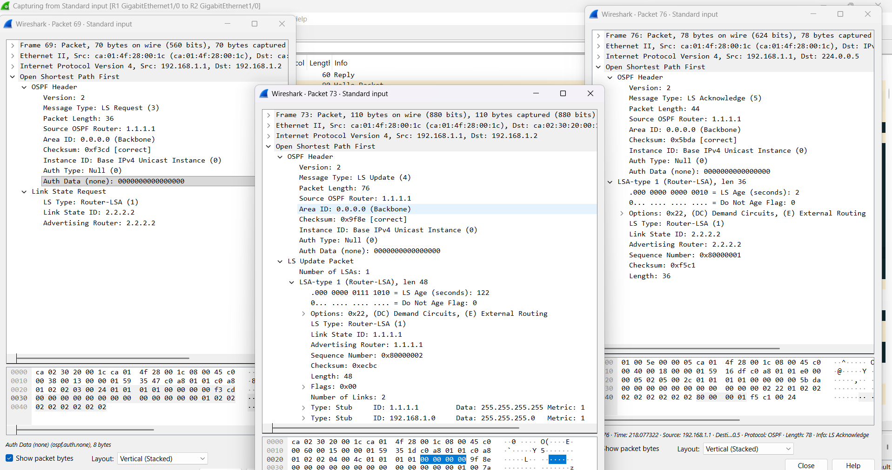
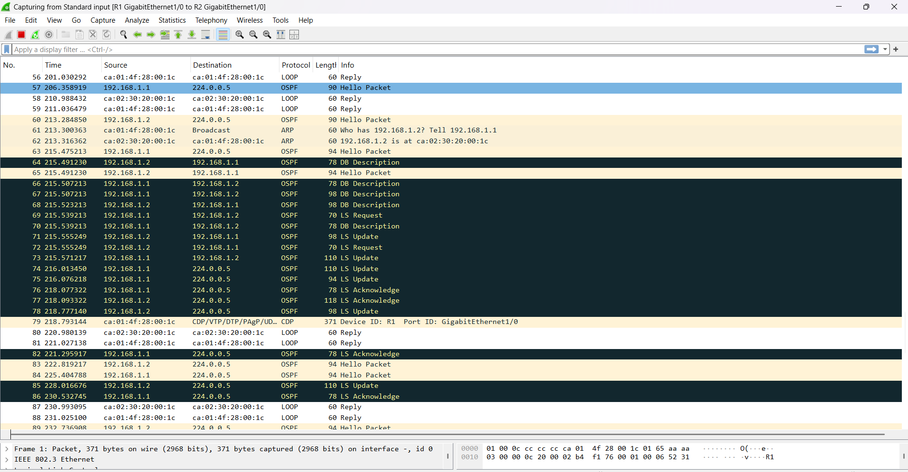
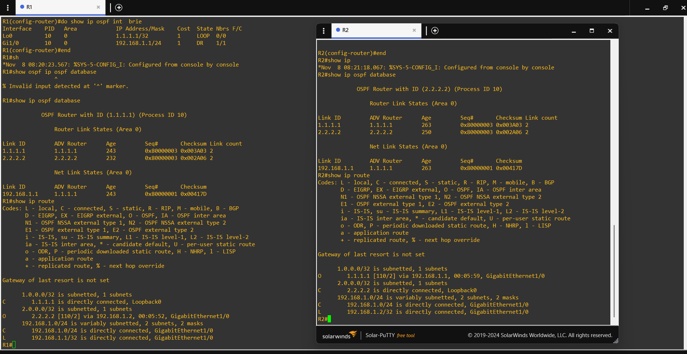

# OSPF Adjacency Process

This section explains how OSPF routers discover neighbors, form adjacencies, exchange link-state information, and synchronize their link-state databases.

## Topics and notes

| Topic | Notes |
|---|---|
| OSPF packet types | [OSPF packet types and common header](screenshots/ospf-packet-types.md) |
| Neighbor states | [OSPF neighbor states](screenshots/ospf-adjacency-states.md) |
| Database synchronization | [DBD exchange, LSR, LSU, and LSAck](screenshots/ospf-database-synchronization.md) |
| Revision | [Practice and interview questions](practice-questions.md) |

## Lab topology

The lab uses two routers:

| Router | Router ID | Interface address |
|---|---|---|
| R1 | 1.1.1.1 | 192.168.1.1/24 |
| R2 | 2.2.2.2 | 192.168.1.2/24 |

Both routers run OSPF process 10 in Area 0. They exchange OSPF packets over the 192.168.1.0/24 network. Hello packets use the OSPF AllSPFRouters multicast address 224.0.0.5.



## Hello packet verification

The Hello packet capture shows the router IDs, Area ID, network mask, Hello interval, Dead interval, router priority, and neighbor information advertised by the routers.

The displayed Hello and Dead intervals are 10 seconds and 40 seconds respectively. Both routers use priority 1. The capture identifies R1 as DR and R2 as BDR for this network.



## Database Description packets

The DBD captures show the routers exchanging database summary information and LSA headers. The later exchange shows R2 (Router ID 2.2.2.2) with the Master bit set and R1 (Router ID 1.1.1.1) with the Master bit clear. This identifies R2 as the master and R1 as the slave in the displayed exchange.

The DBD packets also show an interface MTU of 1500. An MTU mismatch can prevent an OSPF adjacency from progressing; the exact behavior depends on the platform and configuration.



The subsequent DBD exchange shows R2 acting as master and R1 as slave, with Router-LSA headers included in the database summary.



## Link-state request, update, and acknowledgment

The packet capture shows the following exchange:

1. **LSR (Type 3):** R1 requests the Router-LSA for Router ID 2.2.2.2.
2. **LSU (Type 4):** R1 sends a Link State Update containing its Router-LSA. The displayed LSA includes the loopback 1.1.1.1 and the 192.168.1.0/24 network.
3. **LSAck (Type 5):** An acknowledgment packet carries the LSA header for the Router-LSA advertised by R2.

This exchange demonstrates how OSPF routers request missing link-state information, send LSAs, and acknowledge received LSAs.



The broader packet capture also shows OSPF Hello, DBD, LSR, LSU, and LSAck traffic between the routers.



## OSPF database and routing-table verification

The router outputs show Router-LSAs in the OSPF link-state database. The routing tables show the loopback route learned from the other router:

- R1 learns 2.2.2.2/32 through R2.
- R2 learns 1.1.1.1/32 through R1.
- Both routers have the connected 192.168.1.0/24 network.



## Additional scenario: DR and BDR election

A separate three-router broadcast-network scenario demonstrates how OSPF elects a Designated Router (DR), Backup Designated Router (BDR), and DROther when all interfaces have the same priority.

[Read the OSPF DR and BDR election scenario](dr-bdr-election-scenario.md)

## Verification commands

```text
show ip ospf neighbor
show ip ospf interface
show ip ospf database
show ip route
show ip protocols
```
