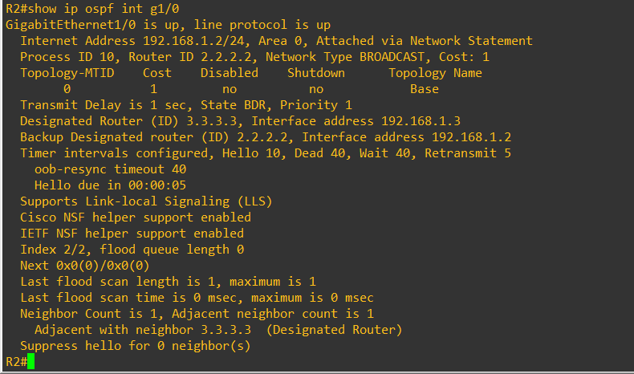
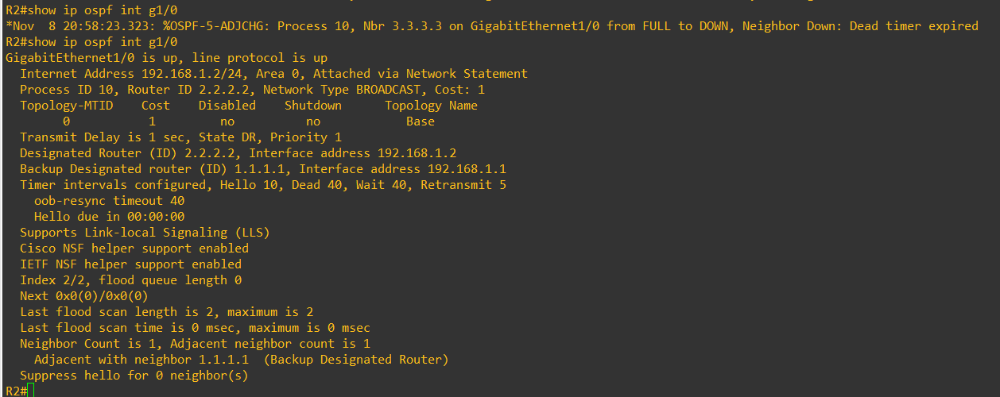
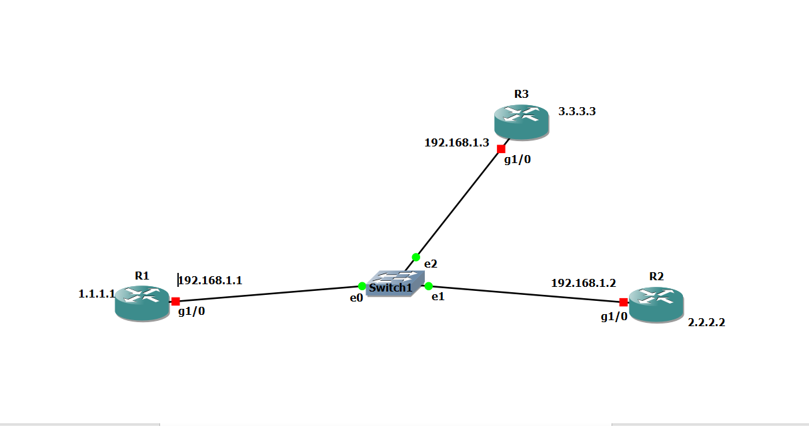

# OSPF DR and BDR Election Scenario

## Topology



Three OSPF routers are connected to the same Ethernet broadcast network through a switch. All three interfaces belong to Area 0 and use OSPF process 10.

| Router | Router ID | Interface IP | OSPF priority | Initial role |
|---|---|---|---:|---|
| R1 (HYD) | 1.1.1.1 | 192.168.1.1/24 | 1 | DROther |
| R2 (BLR) | 2.2.2.2 | 192.168.1.2/24 | 1 | BDR |
| R3 | 3.3.3.3 | 192.168.1.3/24 | 1 | DR |

All three routers use the same OSPF interface priority. Therefore, the highest Router ID wins the DR election, and the next-highest eligible Router ID becomes BDR.

## DR and BDR roles before the failure



The initial output from R2 shows that its GigabitEthernet1/0 interface is in the BDR state. R3 (Router ID 3.3.3.3) is the DR, and R2 (Router ID 2.2.2.2) is the BDR. R2 has one adjacent neighbor, R3, in the DR role.

## DR failure and BDR takeover



R3 is then turned off. R2 stops receiving Hello packets from R3 and detects the neighbor failure when the Dead timer expires. The console reports the neighbor-down event due to Dead timer expiration.

R2, which was already the BDR, takes over the DR role. R1 (Router ID 1.1.1.1) becomes the new BDR.

| Role | Before R3 shutdown | After R3 shutdown |
|---|---|---|
| DR | R3 – 3.3.3.3 | R2 – 2.2.2.2 |
| BDR | R2 – 2.2.2.2 | R1 – 1.1.1.1 |
| R2 interface state | BDR | DR |
| R3 neighbor | FULL adjacency | Down – Dead timer expired |

## How the election works

1. Routers send OSPF Hello packets to discover neighbors and advertise information that includes their Router ID, interface priority, and the DR/BDR they know about.
2. A router with an OSPF interface priority of 0 is not eligible to become DR or BDR.
3. Among eligible routers, the highest interface priority is preferred.
4. If priorities are equal, the highest Router ID is used as the tie-breaker.
5. If the DR fails, the BDR takes over as DR. The remaining eligible routers then determine a replacement BDR.

## Adjacency behavior

- The DR and BDR form full adjacencies with the other OSPF routers on the segment.
- DROther routers normally remain in the 2-Way state with one another.
- On a broadcast network, routers use 224.0.0.5 (AllSPFRouters) to send OSPF Hello packets. OSPF packets destined for the DR and BDR use 224.0.0.6 (AllDRouters).

## Important election behavior

The DR/BDR election is not preemptive. A router with a higher priority or Router ID joining later does not automatically replace an already elected DR. The BDR is the standby router and takes over when the DR becomes unavailable.

## Verification commands

```text
show ip ospf neighbor
show ip ospf interface
show ip ospf interface g1/0
```

Use the neighbor and interface outputs to verify the DR, BDR, DROther roles, interface state, and neighbor status.
