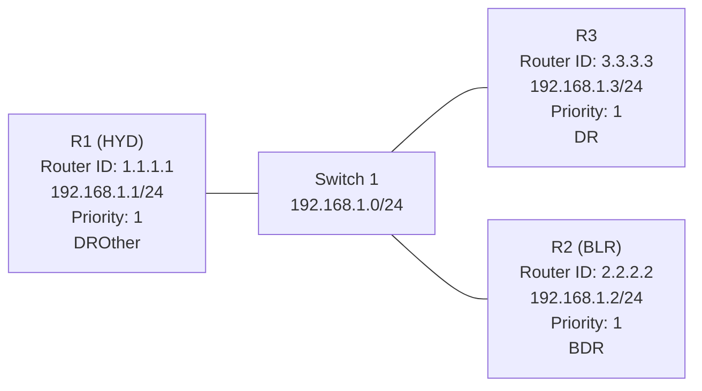

# OSPF DR and BDR Election Scenario

## Topology

Three OSPF routers are connected to the same Ethernet broadcast network through a switch. All three interfaces belong to Area 0 and use OSPF process 10.



| Router | Router ID | Interface IP | OSPF priority | Role |
|---|---|---|---:|---|
| R1 (HYD) | 1.1.1.1 | 192.168.1.1/24 | 1 | DROther |
| R2 (BLR) | 2.2.2.2 | 192.168.1.2/24 | 1 | BDR |
| R3 | 3.3.3.3 | 192.168.1.3/24 | 1 | DR |

## How the election works

On a broadcast multi-access network, OSPF elects a Designated Router (DR) and a Backup Designated Router (BDR) to reduce the number of full adjacencies and organize LSA exchange.

1. Routers send OSPF Hello packets to discover neighbors and advertise information that includes their Router ID, interface priority, and the DR/BDR they know about.
2. A router with an OSPF interface priority of 0 is not eligible to become DR or BDR.
3. Among eligible routers, the highest interface priority is preferred.
4. If priorities are equal, the highest Router ID is used as the tie-breaker.
5. The elected BDR takes over if the DR becomes unavailable. A new BDR is then elected.

In this topology, all three routers have priority 1. Router ID 3.3.3.3 is the highest, so R3 is shown as the DR. Router ID 2.2.2.2 is next highest, so R2 is shown as the BDR. R1 remains a DROther.

## Adjacency behavior

- The DR and BDR form full adjacencies with the other OSPF routers on the segment.
- DROther routers normally remain in the 2-Way state with one another.
- On a broadcast network, routers use 224.0.0.5 (AllSPFRouters) to send OSPF Hello packets. DR/BDR-related updates are also sent using the appropriate OSPF multicast destination, including 224.0.0.6 (AllDRouters).

## Important election behavior

The DR/BDR election is not preemptive. A router with a higher priority or Router ID joining later does not automatically replace an already elected DR. The election occurs when the segment's OSPF neighbor relationships are being established, and a new election can occur when the DR or BDR role becomes vacant.

## Verification commands

```text
show ip ospf neighbor
show ip ospf interface
show ip ospf interface g1/0
```

Use the neighbor and interface outputs to confirm the DR, BDR, and DROther roles. The topology diagram represents the roles shown in the supplied lab topology.
