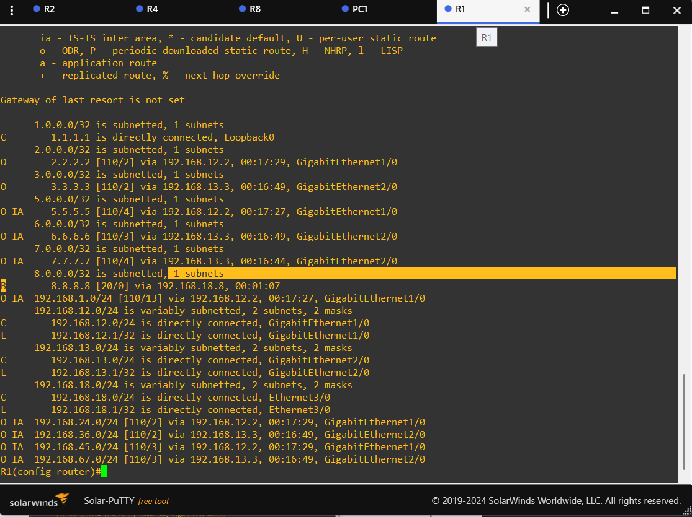
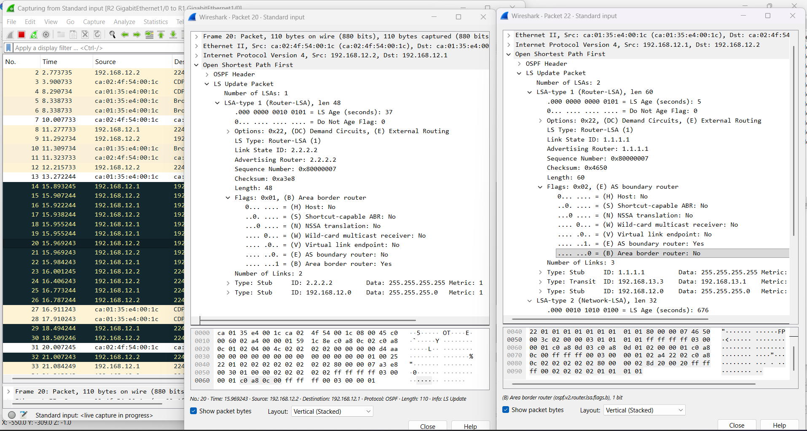
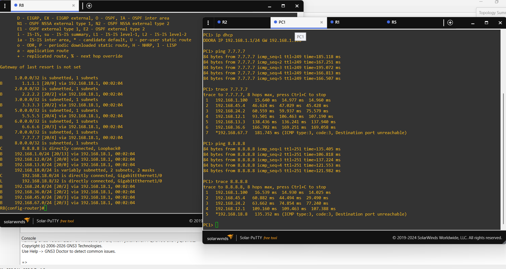
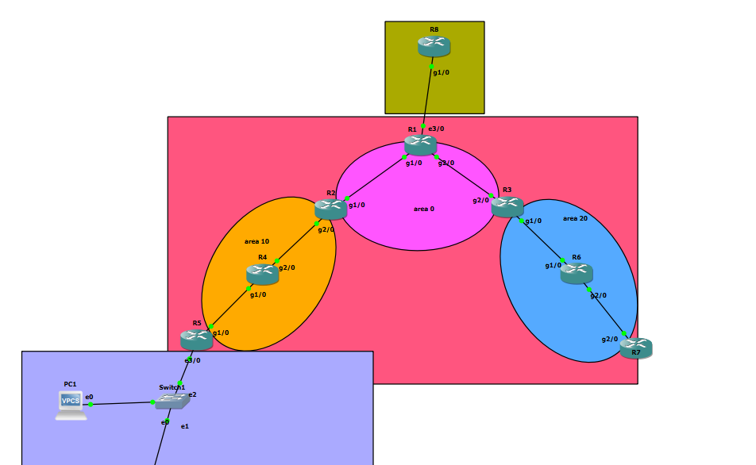
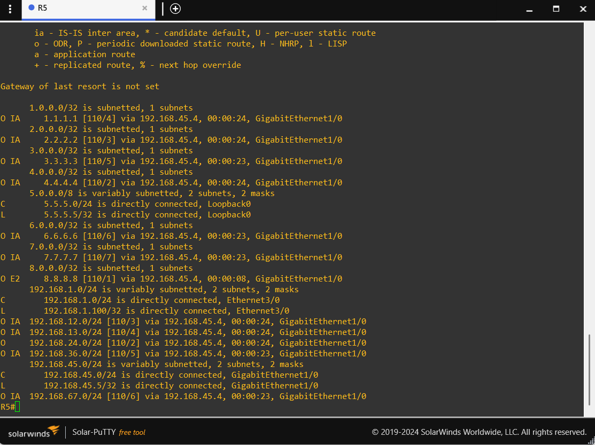
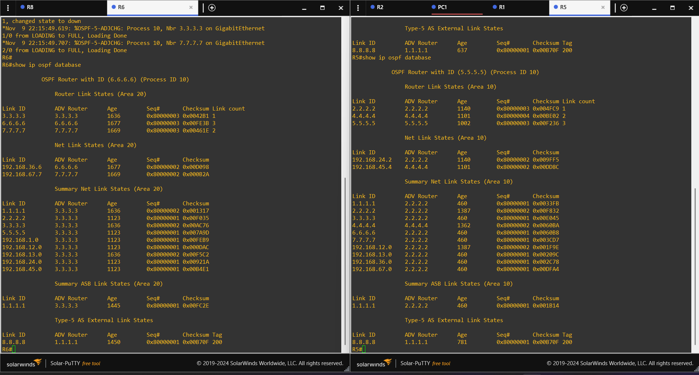

# OSPF External Route Redistribution and LSA Analysis

This lab connects an OSPF multi-area network to an external BGP autonomous system. The work focuses on redistributing routes between BGP and OSPF, identifying the ASBR and ABRs, examining Type 4 and Type 5 LSAs, and verifying the external route on an internal OSPF router.

## Lab objectives

- Establish an eBGP peering between R1 and R8.
- Exchange the external prefix and OSPF internal routes between BGP and OSPF through redistribution on R1.
- Identify the ASBR and ABRs from Type 1 Router-LSA flags.
- Compare Type 4 and Type 5 LSAs in Areas 10 and 20.
- Verify the external destination as an OSPF E2 route on R5.
- Test connectivity from PC1 to an internal destination and the external test destination.

## Topology and area layout

The topology contains an OSPF multi-area domain and an external BGP router.

| Area / domain | Routers | Role |
|---|---|---|
| Area 0 | R1, R2, R3 | OSPF backbone |
| Area 10 | R2, R4, R5 | Non-backbone area |
| Area 20 | R3, R6, R7 | Non-backbone area |
| External AS 200 | R8 | External BGP router |

- **R1 (1.1.1.1):** OSPF ASBR and eBGP peer of R8.
- **R2 (2.2.2.2):** ABR between Area 0 and Area 10. Its G2/0 interface is assigned to Area 10 in this lab.
- **R3 (3.3.3.3):** ABR between Area 0 and Area 20.
- **R8:** External BGP router in AS 200. Its Loopback0 address, 8.8.8.8/32, is used as the external test destination.



## BGP and OSPF redistribution

The eBGP session is configured between R1 and R8 over 192.168.18.0/24:

| Router | Interface address | BGP AS |
|---|---|---|
| R1 | 192.168.18.1/24 | 100 |
| R8 | 192.168.18.8/24 | 200 |

R8 advertises 8.8.8.8/32 through BGP. R1 learns this prefix as a BGP route and redistributes BGP routes into OSPF. R1 also redistributes OSPF routes into BGP so R8 can learn internal OSPF prefixes.

Before redistribution into OSPF, R1's routing table shows the external prefix as a BGP route:

```text
B 8.8.8.8 [20/0] via 192.168.18.8
```

This is the starting point for the redistribution: R1 has learned the external prefix from R8 through BGP.



The configured redistribution statements are:

```text
router ospf 110
 redistribute bgp 100

router bgp 100
 redistribute ospf 110
```

These statements show both redistribution directions. The remaining routing-table and connectivity captures provide the practical verification.

## ASBR and ABR identification

The Wireshark capture contains Type 1 Router-LSAs:

- R2's Router-LSA has the **B (ABR) flag set** and the **E (ASBR) flag clear**.
- R1's Router-LSA has the **E (ASBR) flag set** and the **B (ABR) flag clear**.

This matches the roles in the topology: R1 redistributes the external BGP route into OSPF, while R2 connects Areas 0 and 10.



## Type 4 and Type 5 LSAs

The LSDB output from R5 in Area 10 and R6 in Area 20 shows:

| Router / area | Type 4 Link State ID | Type 4 advertising router | Type 5 Link State ID | Type 5 advertising router |
|---|---|---|---|---|
| R5 / Area 10 | 1.1.1.1 | 2.2.2.2 (R2) | 8.8.8.8 | 1.1.1.1 (R1) |
| R6 / Area 20 | 1.1.1.1 | 3.3.3.3 (R3) | 8.8.8.8 | 1.1.1.1 (R1) |

- **Type 4 – ASBR Summary LSA:** originated by an ABR to advertise reachability information for the ASBR into another area. The Link State ID identifies the ASBR's Router ID.
- **Type 5 – AS External LSA:** originated by the ASBR to advertise the external prefix. In this lab, R1 advertises 8.8.8.8/32.



## External route installed on R5

R5's routing table contains:

```text
O E2 8.8.8.8 [110/1] via 192.168.45.4, GigabitEthernet1/0
```

This confirms that the external prefix has entered OSPF and is installed on R5 as an external Type 2 route. The next hop is R4 at 192.168.45.4.



## Reverse redistribution and end-to-end connectivity

R8's routing table contains BGP routes to internal OSPF prefixes through R1 (192.168.18.1). This is consistent with the OSPF-to-BGP redistribution configured on R1.

PC1 receives its address through DHCP:

- Address: 192.168.1.1/24
- Default gateway: 192.168.1.100

The captured tests show five successful ping replies to both 7.7.7.7 (an internal OSPF loopback) and 8.8.8.8 (the external test loopback on R8).

The traceroute output shows the path through the Area 10 side, R2, the backbone, and then either the internal Area 20 path or R1 toward R8. The final traceroute probes return ICMP destination-port-unreachable messages; the successful ping results separately confirm IP reachability.



After redistribution, R5 installs the external destination as an OSPF E2 route:

```text
O E2 8.8.8.8 [110/1] via 192.168.45.4
```

## What this lab demonstrates

1. eBGP peering between two autonomous systems is configured manually using neighbor statements.
2. R1 learns 8.8.8.8/32 from R8 through BGP.
3. R1 redistributes BGP routes into OSPF and acts as the ASBR.
4. R2 and R3 advertise reachability to the ASBR into their respective non-backbone areas using Type 4 LSAs.
5. R1 advertises the external prefix using a Type 5 LSA.
6. R5 installs 8.8.8.8/32 as an OSPF E2 route.
7. R8 learns internal prefixes through BGP after OSPF-to-BGP redistribution.
8. PC1 successfully pings both the internal loopback 7.7.7.7 and the external test loopback 8.8.8.8.

## Important scope note

The address 8.8.8.8 is configured as Loopback0 on the simulated R8 router. The successful test is therefore reachability to a lab endpoint; it is not a test of access to the real public Google DNS service.

Stub, totally stubby, and NSSA configurations are not included here. They are reserved for the next lab.

## Verification commands

```text
show ip bgp summary
show ip route
show ip ospf database
show ip ospf database asbr-summary
show ip ospf database external
show ip ospf interface brief
show ip route 8.8.8.8
```

## Detailed notes

- [BGP and OSPF route redistribution](route-redistribution.md)
- [OSPF Type 4 and Type 5 LSAs](ospf-type-4-and-type-5-lsas.md)
- [OSPF E1 and E2 external routes](e1-vs-e2.md)
- [Practice and interview questions](practice-questions.md)
