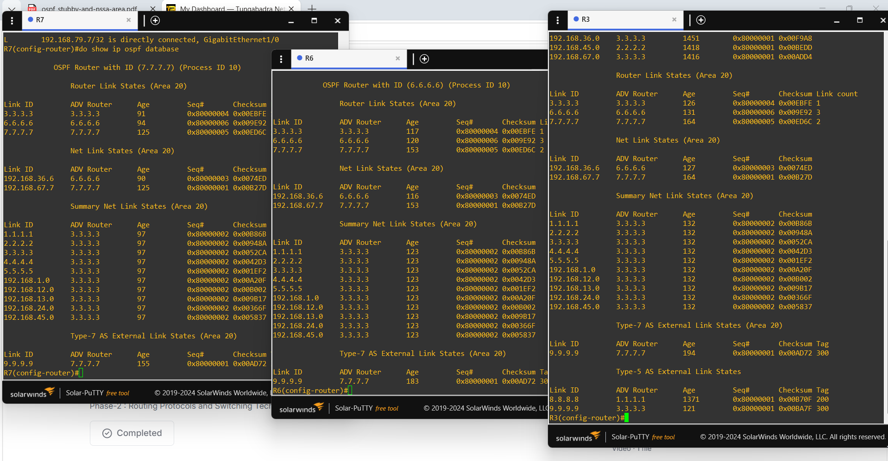
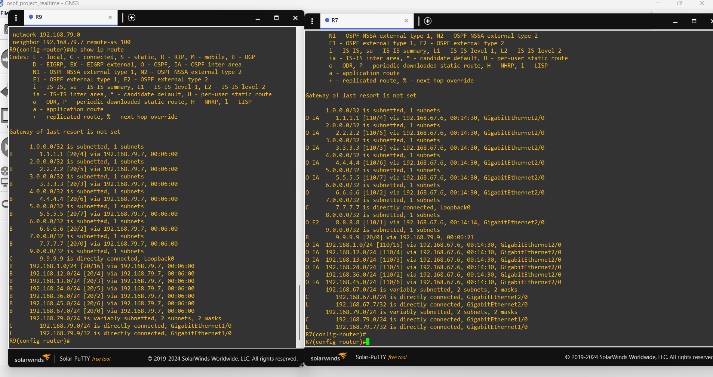

# OSPF Stub Areas, Totally Stubby Areas, NSSA and BGP

The lab started with Area 10 as a stub area. I then changed it to a totally stubby area and compared the LSDB output. After that, I worked with an NSSA in Area 20 and checked how a Type 7 LSA is translated into a Type 5 LSA. The last part covers the BGP connection between R7 and R9.

## Topology

| Area / connection | Routers | Purpose |
|---|---|---|
| Area 0 | R1, R2, R3 | OSPF backbone |
| Area 10 | R4, R5 | Stub area, later changed to totally stubby |
| Area 20 | R6, R7 | NSSA |
| R7–R9 | R7, R9 | BGP connection |
| R1–R8 | R1, R8 | External BGP connection from the earlier lab; R8 has loopback `8.8.8.8/32` |

## Area 10 — Stub area

Notes and configuration: [Stub Area](stub-area.md)

The LSDB output from R4 and R5 shows Type 1, Type 2 and several Type 3 LSAs. The Type 3 entries include the default route and routes for other OSPF areas. This is the output I used as the reference before changing Area 10 to totally stubby.

## Area 10 — Totally stubby area

Notes and configuration: [Totally Stubby Area](totally-stubby-area.md)

After applying the totally-stubby setting, the Area 10 LSDB shows only the default Type 3 summary route, `0.0.0.0`, advertised by R2. The other Type 3 entries from the earlier output are no longer present.

PC1 received five successful replies when pinging `8.8.8.8` and `7.7.7.7`. The traceroute to `8.8.8.8` reached `192.168.18.8`, but the destination returned ICMP type 3, code 3 (destination port unreachable). So the ping test passed, while the traceroute did not finish normally.

## Area 20 — NSSA

Notes and configuration: [NSSA Area](nssa-area.md)

The LSDB on R6 and R7 shows a Type 7 AS External LSA for `9.9.9.9`. Its Advertising Router is `7.7.7.7` and the route tag is `300`.

R3's Area 20 database also shows the Type 7 entry. In R3's Type 5 section, `9.9.9.9` appears with Advertising Router `3.3.3.3` and tag `300`. This is the Type 7-to-Type 5 translation at R3.

R3's Type 5 section also lists `8.8.8.8`, advertised by `1.1.1.1`. That is the separate external route from the R1–R8 setup, not the `9.9.9.9` route used for this NSSA test.

## BGP between R7 and R9

Notes and configuration: [BGP and Redistribution](bgp-and-redistribution.md)

R9 is configured with R7 (`192.168.79.7`) as a BGP neighbor in AS 100. R9's routing table shows BGP routes through R7, and R7's routing table shows `9.9.9.9/32` through R9 (`192.168.79.9`).

R7 also has the BGP-learned `9.9.9.9/32` route represented in Area 20 as a Type 7 LSA. R3 then translates it into a Type 5 LSA for the rest of the OSPF domain.

The screenshots show the routing-table entries, but do not include `show ip bgp summary`. I have therefore not marked the BGP neighbor's Established state as separately verified.
