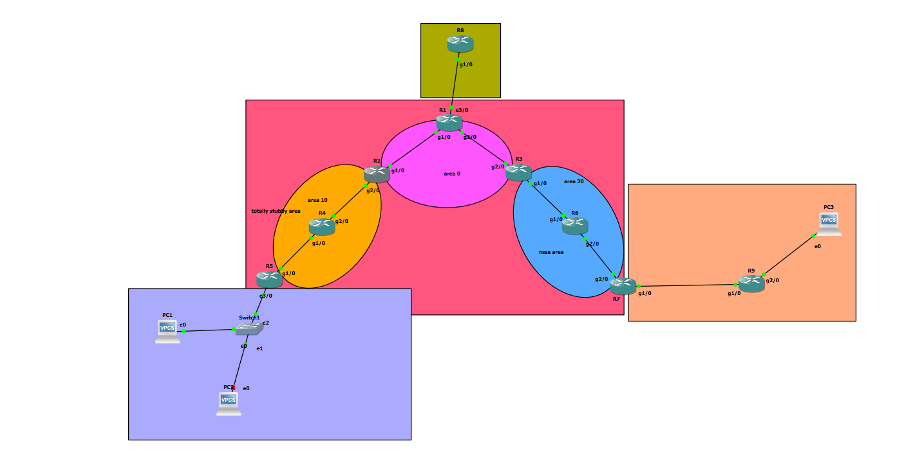

# OSPF Stub Areas, Totally Stubby Areas, and NSSA

This lab examines OSPF stub-area behavior, totally stubby area behavior, and an NSSA connected to an external routing domain.

## Topology overview

| Area / network | Routers and devices | Role shown in the topology |
|---|---|---|
| Area 0 | R1, R2, R3 | OSPF backbone |
| Area 10 | R4, R5 | Totally stubby area in the topology |
| Area 20 | R6, R7 | NSSA in the topology |
| External connection | R1–R8 | External routing connection |
| PC1/PC2 LAN | R5 and Switch1 | End devices on the Area 10 side |
| PC3 LAN | R7–R9 | End device on the Area 20 side through R9 |

The topology labels describe the intended design. The practical observations below are based on the uploaded router outputs and endpoint tests.

## Area 10 — Stub area LSDB

The LSDB output from R4 and R5 shows Router LSAs (Type 1), Network LSAs (Type 2), and multiple Summary Net LSAs (Type 3). The Type 3 entries include the default route (0.0.0.0) as well as other summarized networks.

This is the stub-area observation captured before applying the totally-stubby configuration.

## Area 10 — Totally stubby area

The configuration output shows `area 10 stub no-summary` on R4 and R5. In the resulting Area 10 LSDB, the Summary Net Link States section contains only the default summary route, `0.0.0.0`, advertised by R2. The other Type 3 summary entries visible in the earlier stub-area output are absent.

PC1 successfully pinged both `8.8.8.8` and `7.7.7.7` with five replies each. The traceroute to `8.8.8.8` reached `192.168.18.8`, where the output reported ICMP type 3, code 3 (destination port unreachable). The successful ping is the connectivity test; the traceroute response is recorded separately and is not described as a fully successful traceroute.

## Area 20 — NSSA

The NSSA LSDB and Type 7-to-Type 5 translation observations are to be added with their corresponding screenshots.

## BGP between R7 and R9

The BGP configuration and routing-table observations are to be added with their corresponding screenshot.

## Verification still to document

- OSPF neighbor states for the relevant routers
- Routing-table comparison across the stub and totally stubby configurations
- NSSA Type 7 LSA and Type 5 translation details
- BGP peer state and route exchange between R7 and R9
