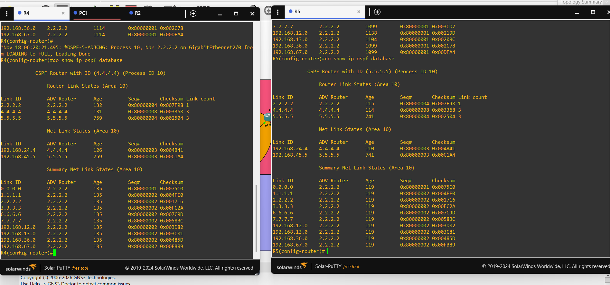
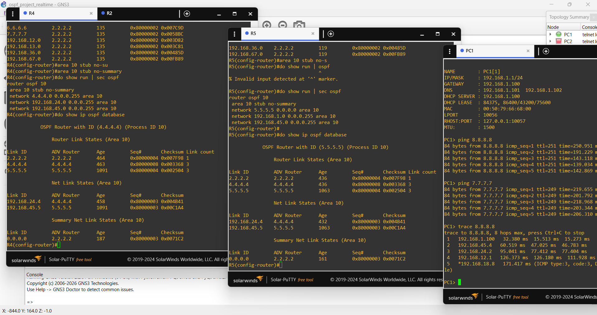

# OSPF Stub Areas, Totally Stubby Areas, and NSSA

This lab examines OSPF stub-area behavior, totally stubby area behavior, and an NSSA connected to an external routing domain. It also records BGP route exchange between R7 and R9.

## Topology overview


| Area / network | Routers and devices | Role shown in the topology |
|---|---|---|
| Area 0 | R1, R2, R3 | OSPF backbone |
| Area 10 | R4, R5 | Totally stubby area in the topology |
| Area 20 | R6, R7 | NSSA in the topology |
| External connection | R1–R8 | External routing connection |
| PC1/PC2 LAN | R5 and Switch1 | End devices on the Area 10 side |
| PC3 LAN | R7–R9 | End device on the Area 20 side through R9 |

The topology labels describe the intended design. Practical observations below are based on the uploaded router outputs and endpoint tests.

## Area 10 — Stub area LSDB



The LSDB output from R4 and R5 shows Router LSAs (Type 1), Network LSAs (Type 2), and multiple Summary Net LSAs (Type 3). The Type 3 entries include the default route (0.0.0.0) as well as other summarized networks.

This is the stub-area observation captured before applying the totally-stubby configuration.

## Area 10 — Totally stubby area



The configuration output shows `area 10 stub no-summary` on R4 and R5. In the resulting Area 10 LSDB, the Summary Net Link States section contains only the default summary route, `0.0.0.0`, advertised by R2. The other Type 3 summary entries visible in the earlier stub-area output are absent.

PC1 successfully pinged both `8.8.8.8` and `7.7.7.7` with five replies each. The traceroute to `8.8.8.8` reached `192.168.18.8`, where the output reported ICMP type 3, code 3 (destination port unreachable). The successful ping is the connectivity test; the traceroute response is recorded separately and is not described as a fully successful traceroute.

## Area 20 — NSSA Type 7 LSA and Type 5 translation

The LSDB outputs from R6 and R7 show a Type 7 AS External LSA in Area 20:

- Link State ID: `9.9.9.9`
- Advertising Router: `7.7.7.7`
- Route tag: `300`

R3's Area 20 LSDB also contains the Type 7 LSA for `9.9.9.9`. R3's Type 5 AS External LSA section shows `9.9.9.9` advertised by Router ID `3.3.3.3`, with tag `300`. This is the Type 7-to-Type 5 translation observed at R3, the NSSA ABR.

The same R3 Type 5 section also shows `8.8.8.8` advertised by `1.1.1.1`. This is a separate external route and should not be confused with the translated `9.9.9.9` route.

## BGP between R7 and R9

The R9 configuration output shows:

```
neighbor 192.168.79.7 remote-as 100
network 192.168.79.0
```

R9's routing table contains BGP routes to internal router loopbacks and network prefixes through next hop `192.168.79.7`. R7's routing table shows a BGP route to `9.9.9.9/32` through `192.168.79.9`. The R7 output also shows the OSPF external route to `8.8.8.8/32` as `O E2`, via `192.168.67.6`.

These routing-table entries support that routes are being exchanged between R7 and R9. The provided screenshot does not show `show ip bgp summary`, so the BGP neighbor's Established state is not separately captured.

## Verification still useful to capture

- OSPF neighbor states for the relevant routers
- A direct `show ip bgp summary` output, if you later want explicit BGP session-state evidence
