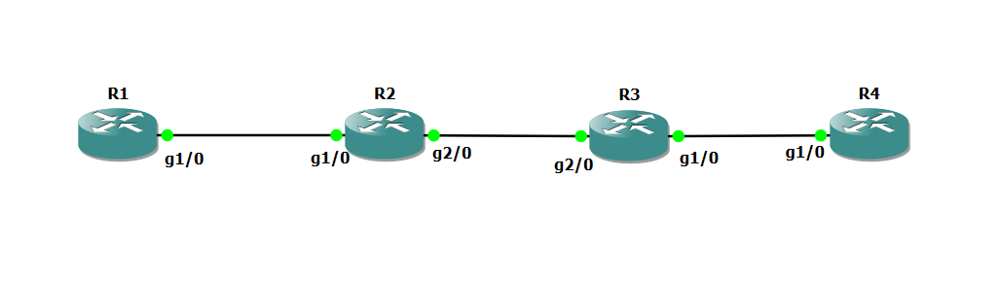
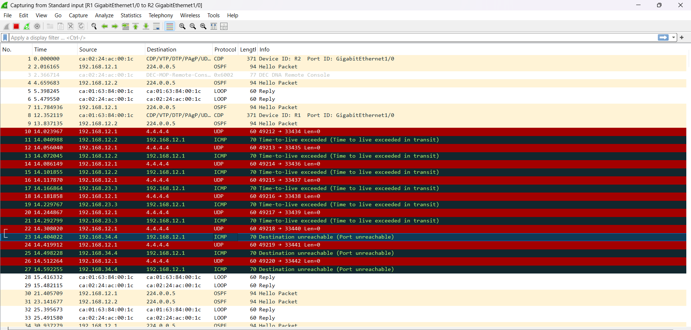
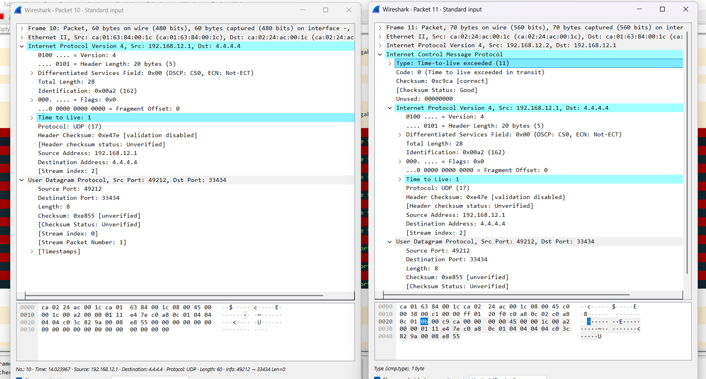
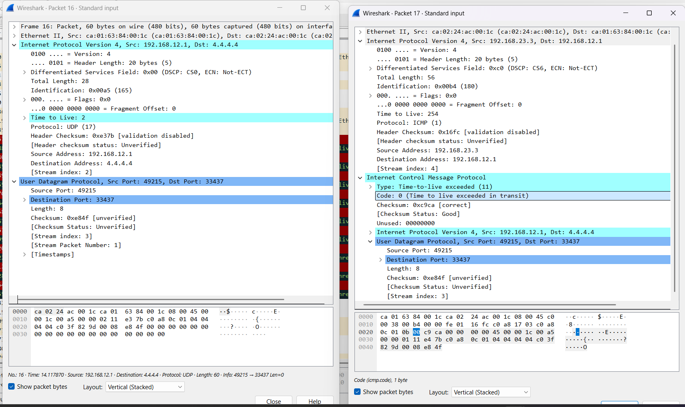
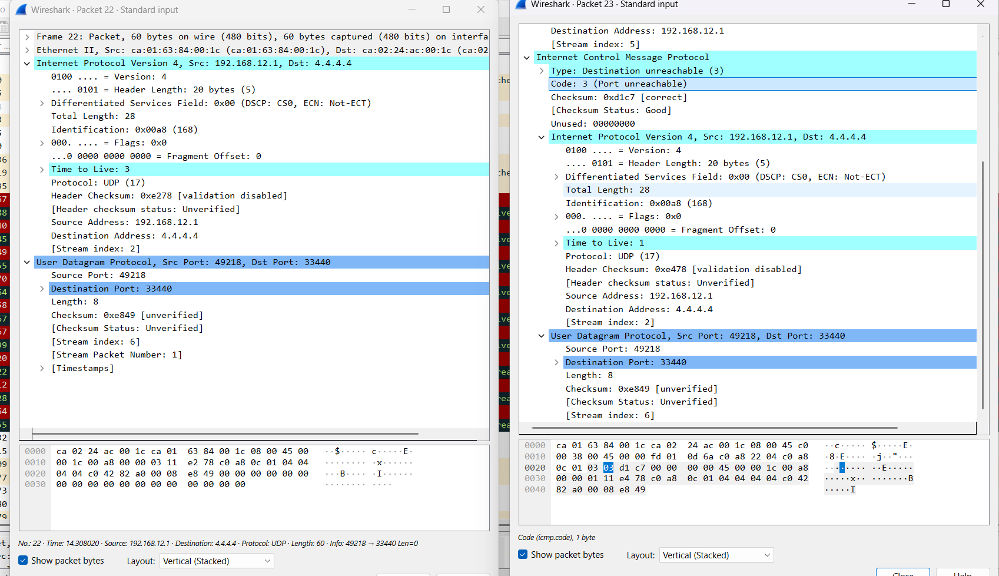

# Traceroute and Tracert

In this topic, I looked at how traceroute finds the routers between a source and a destination. I used Wireshark to inspect the UDP probes and the ICMP replies in a four-router topology.

The notes cover TTL-based hop discovery, UDP probes, ICMP responses, and how to read traceroute results. The practical section below records the packet capture from the R1–R2 link.

## Topics

| Topic | Notes |
|---|---|
| TTL and hop discovery | [TTL and Hop Discovery](ttl-and-hop-discovery.md) |
| Probe packets and ICMP responses | [Traceroute Packet Analysis](traceroute-packet-analysis.md) |
| Reading output and troubleshooting | [Troubleshooting](troubleshooting.md) |
| Revision | [Practice and Interview Questions](practice-questions.md) |

## Commands covered

**Linux / Unix**
~~~bash
traceroute 4.4.4.4
~~~

**Windows**
~~~text
tracert 4.4.4.4
~~~

The command syntax and probe method can vary by platform and implementation. The practical packet capture documented here shows UDP probes.

## Practical topology

The test used four routers connected in a line:

~~~text
R1 G1/0 --- G1/0 R2 G2/0 --- G2/0 R3 G1/0 --- G1/0 R4
~~~

The Wireshark capture was taken on the R1 GigabitEthernet1/0 to R2 GigabitEthernet1/0 link.

## Traceroute packet capture

The probe destination was **4.4.4.4**, and the source address shown in the capture was **192.168.12.1**.

| TTL | Response source | ICMP response | What happened |
|---:|---|---|---|
| 1 | 192.168.12.2 (R2) | Type 11, Code 0 | The probe's TTL expired at R2. |
| 2 | 192.168.23.3 (R3) | Type 11, Code 0 | The probe's TTL expired at R3. |
| 3 | 192.168.34.4 (R4) | Type 3, Code 3 | R4 returned Port Unreachable for the UDP probe. |

### TTL 1 — R2 response

### TTL 2 — R3 response

### TTL 3 — R4 Port Unreachable response

Three UDP probes were sent for each TTL value. The source UDP port shown starts at 49212 and increases, while the destination ports start at 33434 and increase.

The final response is sourced from **192.168.34.4**, while the probe destination is **4.4.4.4**.
