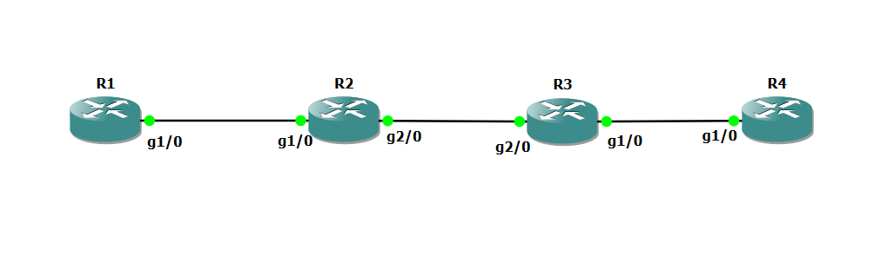
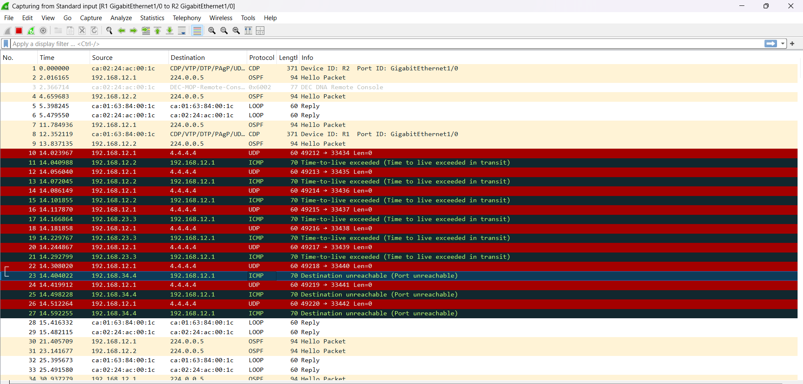
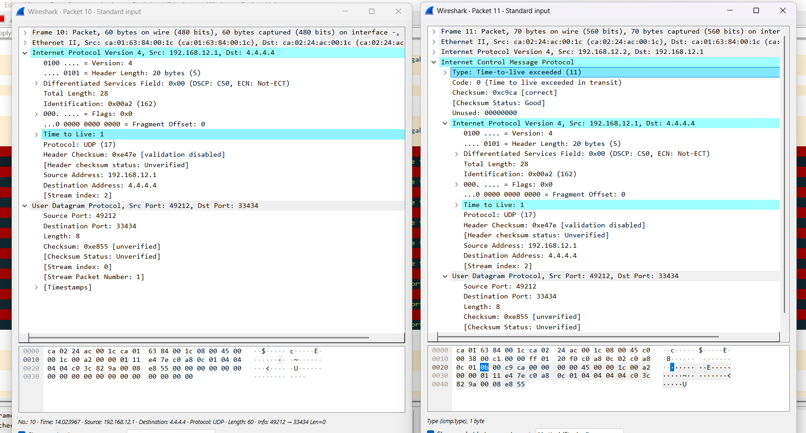
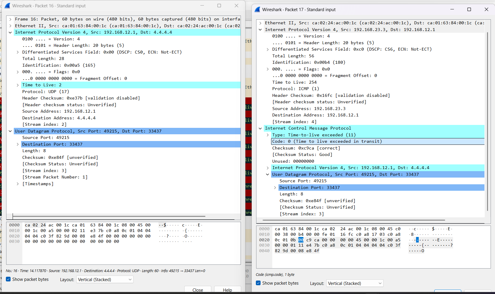
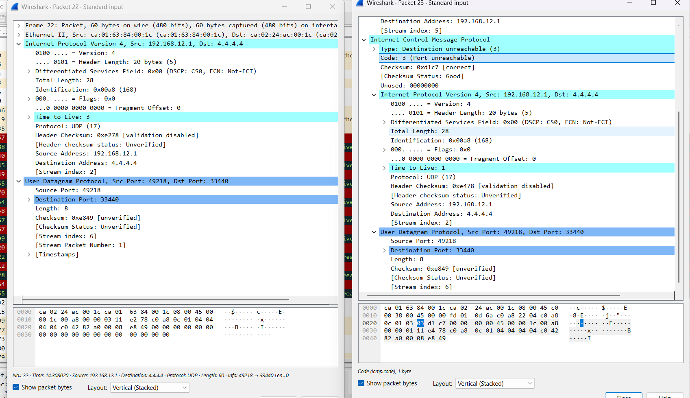

# Day 16 Screenshots

## Traceroute topology

The four-router topology used for this capture.

## Packet capture overview

The packet list showing the UDP probes and ICMP responses for TTL values 1, 2, and 3.

## TTL 1 — R2 response

UDP probes with TTL 1 and the ICMP Time Exceeded response from 192.168.12.2 (R2).

## TTL 2 — R3 response

UDP probes with TTL 2 and the ICMP Time Exceeded response from 192.168.23.3 (R3).

## TTL 3 — R4 Port Unreachable response

UDP probes with TTL 3 and the ICMP Destination Unreachable, Code 3 response sourced from 192.168.34.4.

