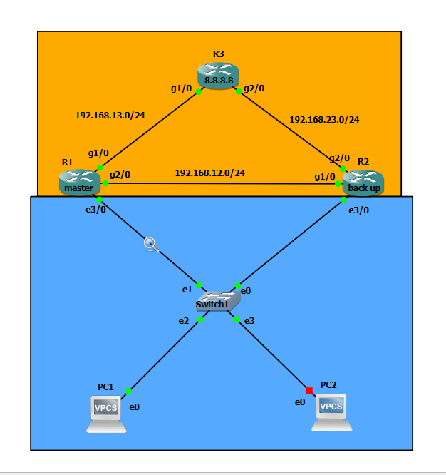
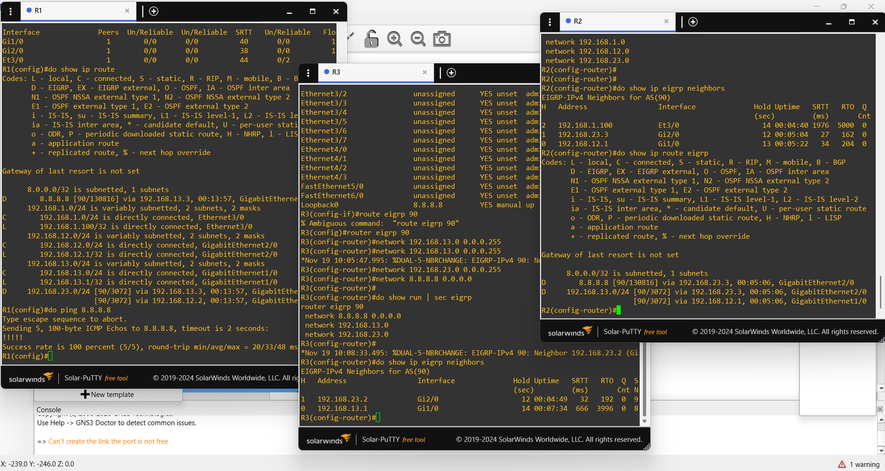
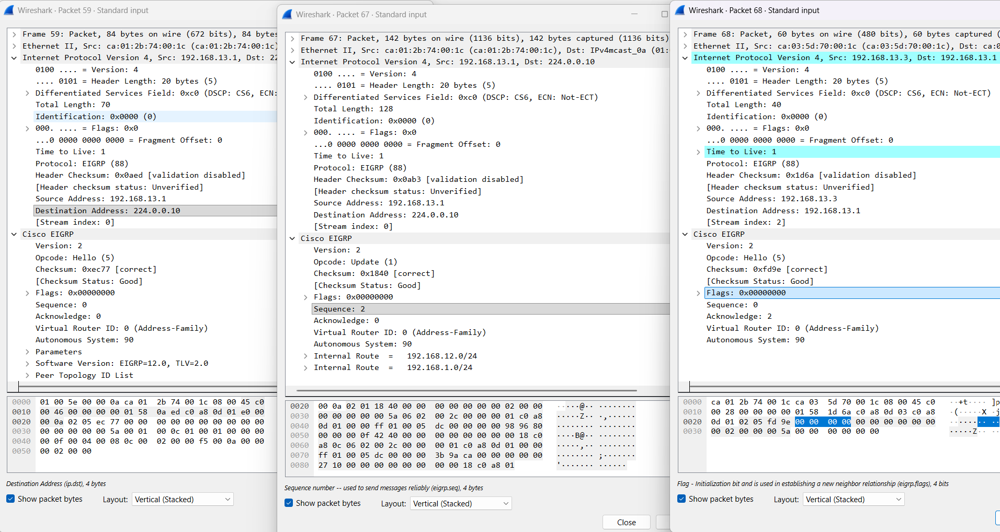
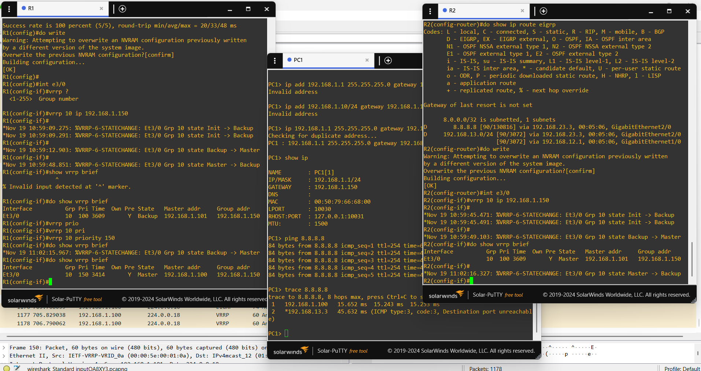
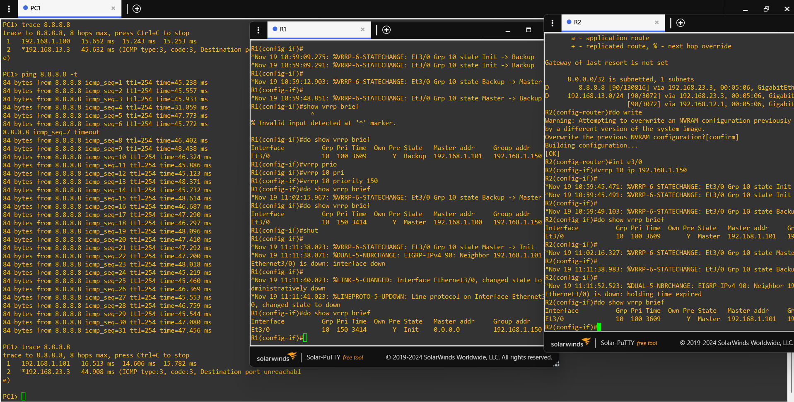
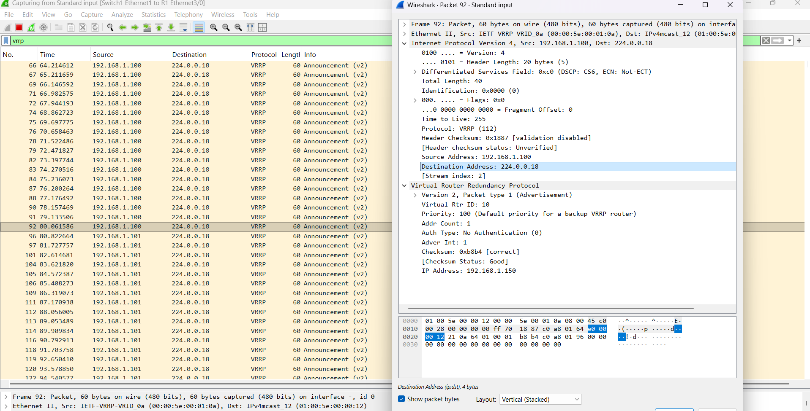
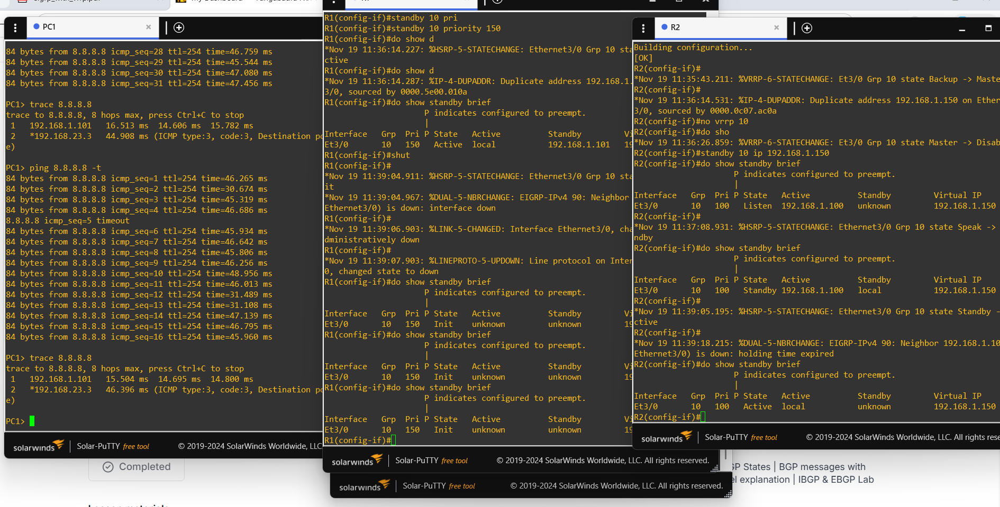
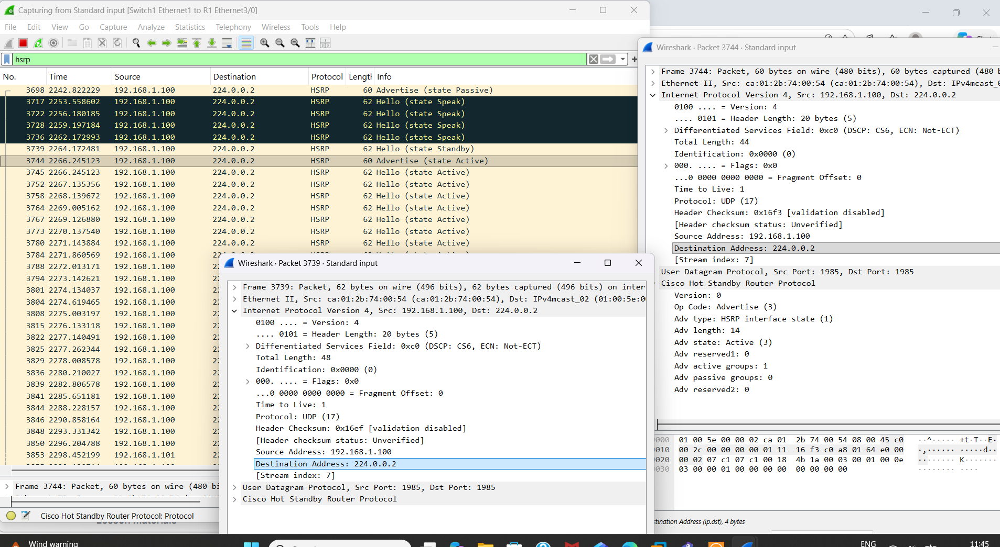

# EIGRP, VRRP and HSRP

In this lab, I configured EIGRP between three routers and tested gateway redundancy with VRRP and HSRP. I also used Wireshark to look at the control packets exchanged by these protocols.

The addressing in my practical topology is different from the example addressing in the study material. The notes below use the addresses from my actual lab.

## Topology and addressing

The three routers form a triangle. R1 and R2 connect to the same LAN through Switch1. PC1 uses the virtual gateway, and R3 has Loopback0 configured as the test destination.

| Device | Interface | Address |
|---|---|---|
| R1 | G1/0 | 192.168.12.1/24 |
| R1 | G2/0 | 192.168.13.1/24 |
| R1 | E3/0 | 192.168.1.100/24 |
| R2 | G1/0 | 192.168.12.2/24 |
| R2 | G2/0 | 192.168.23.2/24 |
| R2 | E3/0 | 192.168.1.101/24 |
| R3 | G1/0 | 192.168.23.3/24 |
| R3 | G2/0 | 192.168.13.3/24 |
| R3 | Loopback0 | 8.8.8.8/32 |
| PC1 | LAN | 192.168.1.1/24 |

The shared virtual gateway used in the practical work was **192.168.1.150**.

## EIGRP

I configured EIGRP using AS 90. The neighbor tables showed adjacencies between the routers, and R1 learned the route to 8.8.8.8/32 through R3. R1's ping to 8.8.8.8 completed with 5 replies out of 5.

The Wireshark capture on the R1–R3 link showed an EIGRP Hello, an Update carrying route entries, and a Hello-format acknowledgment for Update sequence 2.

See [EIGRP notes](eigrp.md) for the configuration and packet details.

## VRRP

VRRP Group 10 used virtual IP 192.168.1.150. R1 was configured with priority 150 and R2 used the default priority 100. PC1 used 192.168.1.150 as its default gateway.

After R1 Ethernet3/0 was shut down, R2 became VRRP Master. The PC's first traceroute hop changed from 192.168.1.100 to 192.168.1.101. The continuous ping showed a brief timeout during the transition and then continued receiving replies.

The selected VRRP packet was an Advertisement sent to 224.0.0.18 using IP protocol 112. The packet details are recorded in the [VRRP notes](vrrp.md).

## HSRP

I then tested HSRP Group 10 with the same virtual IP, 192.168.1.150. R1 was Active and R2 Standby. When R1's Ethernet3/0 interface was shut down, R2 changed to Active. The continuous ping showed a timeout during the transition before replies resumed.

The Wireshark capture showed HSRP messages sent to 224.0.0.2 using UDP port 1985. The selected Advertisement packet reported the Active state.

See [HSRP notes](hsrp.md) and the [VRRP/HSRP comparison](vrrp-and-hsrp-comparison.md).

## Practical results

- EIGRP neighbors formed in AS 90.
- R1 learned the route to 8.8.8.8/32 through R3 and pinged it successfully.
- VRRP and HSRP both used 192.168.1.150 as the virtual gateway in their respective tests.
- In both failover tests, R2 took over after R1's LAN-facing interface was shut down.
- The ping tests showed a brief interruption during failover; the transition was not loss-free.

## Revision

- [Practice questions](practice-questions.md)
